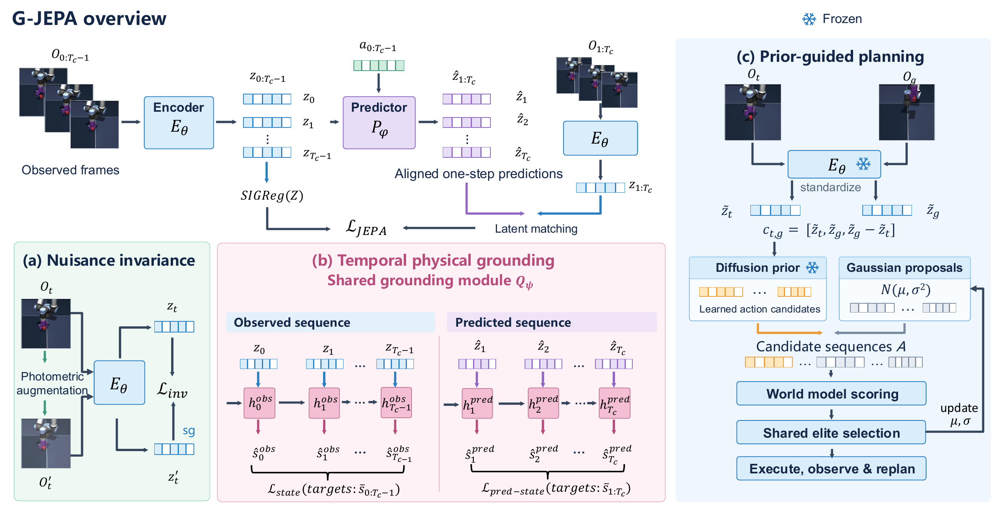
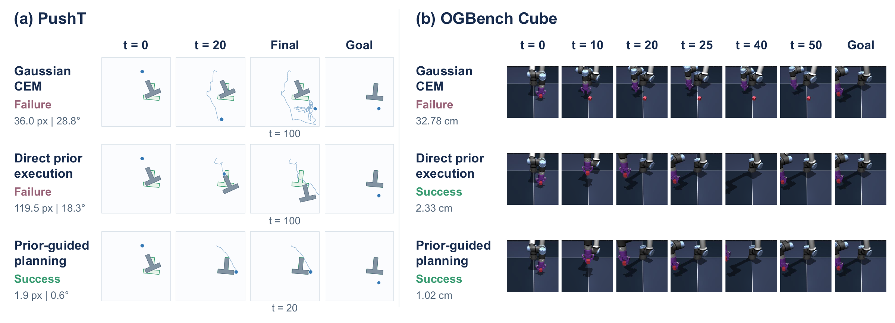

# G-JEPA

### Temporal Context-Aware Physical Grounding in Latent World Models

G-JEPA combines temporal physical grounding with prior-guided action planning. A shared causal temporal module grounds observed and predicted latent sequences in physical states. During planning, a learned action prior supplies proposals that are refined together with Gaussian candidates using the world model.

This codebase is developed from [LeWorldModel (LeWM)](https://github.com/lucas-maes/le-wm). It includes temporal physical grounding, an action prior, and examples for training, planning, simulator execution, and trajectory visualization.



[Overview in PDF format](assets/overview.pdf)

## Installation

Use Python 3.11 or 3.12. A CUDA GPU is recommended for training.

```bash
git clone https://github.com/myl11045/G-JEPA.git
cd G-JEPA
python3.11 -m venv .venv
source .venv/bin/activate
pip install torch==2.5.1 torchvision==0.20.1 --index-url https://download.pytorch.org/whl/cu121
pip install -r requirements.txt
```

For simulation and visualization, install the optional dependencies:

```bash
pip install -r requirements-sim.txt
```

## Data

Download the image-based HDF5 datasets linked in [LeWorldModel](https://github.com/lucas-maes/le-wm#data) and set their location:

```bash
export GJEPA_DATA_DIR=/path/to/datasets
```

```text
$GJEPA_DATA_DIR/
├── pusht_expert_train.h5
├── cube_single_expert.h5
└── tworoom.h5
```

The Cube configuration uses the image dataset with physical-state observations. Dataset paths, training budgets, and loss weights are configured under `configs/train/`.

## World-model training

For example, train G-JEPA on PushT:

```bash
python train.py --domain pusht output_dir=runs/pusht/world
```

Use `--domain cube` or `--domain tworooms` with the corresponding dataset. Hydra overrides can change individual settings:

```bash
python train.py --domain cube output_dir=runs/cube/world loader.batch_size=128
```

Training saves model weights, the architecture configuration, normalization statistics, and a checkpoint for resuming. Resume an interrupted run with `resume=true` and the same output directory.

The default configuration enables observed-state grounding, nuisance invariance, and predicted-state grounding. The two temporal branches share parameters and process their sequences separately. The physical-state head is used during training.

### S4D temporal grounding

The temporal module is implemented in [`gjepa/s4d.py`](gjepa/s4d.py): `S4DLayer` performs the causal diagonal recurrence, and `S4DDecoder` stacks two layers with a physical-state readout. The PushT configuration has 55.4K trainable parameters in this head. Observation and prediction sequences use the same decoder with independently initialized recurrent memory. [`gjepa/world_model.py`](gjepa/world_model.py) connects it to the world model, and the training modules apply the two physical-state losses.

## Action-prior training

After world-model training, cache its frozen latent representations:

```bash
python cache_latents.py --domain pusht \
  --data "$GJEPA_DATA_DIR/pusht_expert_train.h5" \
  --world runs/pusht/world/weights_epoch_20.pt \
  --output cache/pusht

python train_prior.py --cache cache/pusht --output runs/pusht/prior
```

For Cube, use `--domain cube`, `cube_single_expert.h5`, and `runs/cube/world/weights_epoch_10.pt`, with `cache/cube` and `runs/cube/prior` as output directories.

The action prior conditions on the current latent, goal latent, and their difference. This implementation uses a diffusion model to generate 25 actions. Training settings such as `--epochs` and `--batch` can be changed through the command line.

## Loading models

Download pretrained PushT and OGBench Cube models from [Hugging Face](https://huggingface.co/myl11045/G-JEPA):

```bash
pip install -U huggingface_hub
hf download myl11045/G-JEPA --local-dir weights
```

```python
from gjepa.io import load_world, load_prior

world_path = "weights/pusht/world.pt"
world = load_world(world_path, device="cuda")
prior = load_prior("weights/pusht/prior.pt", device="cuda", world_path=world_path)
```

Replace `pusht` with `cube` to load the Cube model.

## Planning example

Generate a plan from two frames in a dataset episode using the [pretrained weights](#loading-models):

```bash
python plan.py --domain pusht \
  --data "$GJEPA_DATA_DIR/pusht_expert_train.h5" \
  --world weights/pusht/world.pt \
  --prior weights/pusht/prior.pt \
  --episode 0 --start 0 --goal-offset 25 \
  --output runs/pusht/plan.json
```

The example mixes learned proposals with Gaussian candidates, scores them with the world model, and saves the selected action sequence in environment action units. Use `--mode cem` without `--prior` for Gaussian CEM. Candidate counts, elite counts, iterations, and the learned-proposal ratio are configurable.

`plan.py` demonstrates one planning round. The simulation example below executes an action prefix and generates a new plan from the updated observation while keeping the goal fixed.

## Simulation and visualization



[View the example in PDF format](assets/GJEPA_execution.pdf)

Run closed-loop PushT planning with the [pretrained weights](#loading-models) and save the rollout:

```bash
python simulate.py --domain pusht \
  --data "$GJEPA_DATA_DIR/pusht_expert_train.h5" \
  --world weights/pusht/world.pt \
  --prior weights/pusht/prior.pt \
  --stop-on-success --output runs/pusht/mixed
```

Export trajectory figures, goal-error curves, and a GIF:

```bash
python plot_rollout.py runs/pusht/mixed \
  --snapshots 4 --gif --output runs/pusht/figures
```

For OGBench Cube, use `--domain cube` with the Cube dataset and weights.

## Code structure

Main files and directories:

```text
G-JEPA/
├── configs/train/          # Training configurations
├── gjepa/                  # Python package
│   ├── s4d.py              # Temporal physical grounding
│   ├── world_model.py      # LeWM-based world model
│   ├── backbone.py         # Visual encoder
│   ├── modules.py          # Predictor and shared network layers
│   ├── invariance.py       # Appearance augmentation and invariance loss
│   ├── action_prior.py     # Conditional action prior
│   ├── planning.py         # CEM search and latent rollout
│   ├── control.py          # Image-conditioned planning interface
│   ├── simulation.py       # PushT / Cube simulator adapters
│   ├── io.py               # Model loading and image preprocessing
│   ├── training/           # World-model training for each task
│   ├── data/               # Cube and TwoRooms data utilities
│   └── envs/               # PushT environment
├── train.py                # World-model training entry point
├── cache_latents.py        # Frozen latent extraction
├── train_prior.py          # Action-prior training
├── plan.py                 # Single-round planning
├── simulate.py             # Closed-loop simulation
├── plot_rollout.py         # Figures and GIF export
├── assets/                 # Overview and planning examples
├── tests/                  # Core module and entry-point checks
├── requirements.txt        # Core dependencies
├── requirements-sim.txt    # Simulation and plotting dependencies
└── pyproject.toml          # Package configuration
```

## Acknowledgments

Our implementation builds on [LeWorldModel](https://github.com/lucas-maes/le-wm)
and uses [stable-pretraining](https://github.com/galilai-group/stable-pretraining)
and [stable-worldmodel](https://github.com/galilai-group/stable-worldmodel).
The PushT planning objective follows the
[AdaJEPA](https://github.com/agentic-learning-ai-lab/adajepa) implementation,
and the PushT simulator is adapted from
[DINO-WM](https://github.com/gaoyuezhou/dino_wm).
Original copyright and license notices are retained in [LICENSE](LICENSE).
